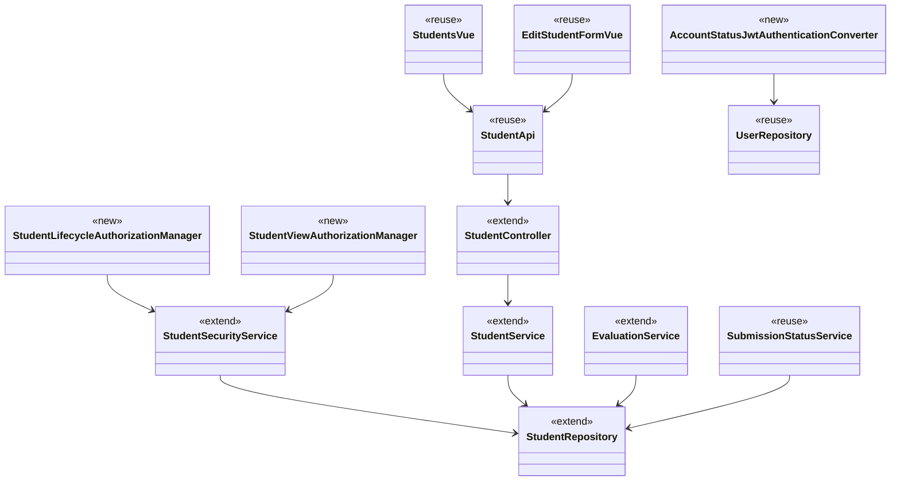
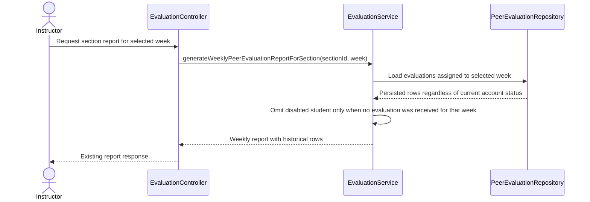

# Student Design

> Realizes: [UC-STU-deactivate-student](../requirements/use-cases.md#uc-stu-deactivate-student-the-course-admininstructor-deactivates-a-student)
> Depends on FRs: `FR-SEC-authentication`, `FR-SEC-authorization`, `FR-SEC-deny-unauthorized`, `FR-SEC-active-account`
> See: [SRS Business Domain Model](../requirements/software-requirements-specification.md#business-domain-model), [architecture Container and Component diagrams](architectural-design.md)

## Overview

The student lifecycle uses the existing `student` bounded context and shared security subsystem in the REST API container. Deactivation changes the existing account-enabled flag only; it retains team assignment and submitted work. The report and reminder consequences are implemented by reusing the performance-tracking services, not by adding a separate lifecycle store.

## Components & classes



| Reuse | Component | File |
|---|---|---|
| Reuse | Student list and confirmation action | [`Students.vue`](../../frontend/src/pages/students/Students.vue) |
| Reuse, revise | Student edit form; remove enabled switch | [`EditStudentForm.vue`](../../frontend/src/pages/students/EditStudentForm.vue) |
| Reuse, extend | Student API client | [`apis/student/index.ts`](../../frontend/src/apis/student/index.ts) |
| Reuse, extend | Student controller | [`StudentController.java`](../../backend/src/main/java/team/projectpulse/student/StudentController.java) |
| Reuse, extend | Student service | [`StudentService.java`](../../backend/src/main/java/team/projectpulse/student/StudentService.java) |
| Reuse, extend | Scoped student lookup | [`StudentRepository.java`](../../backend/src/main/java/team/projectpulse/student/StudentRepository.java) |
| Reuse, extend | Student lifecycle security checks | [`StudentSecurityService.java`](../../backend/src/main/java/team/projectpulse/student/StudentSecurityService.java) |
| New | Course-admin-or-assigned-instructor lifecycle route guard | `backend/src/main/java/team/projectpulse/security/authorizationmanagers/StudentLifecycleAuthorizationManager.java` |
| New | Student-detail route guard for the student, assigned instructor, or owning course admin | `backend/src/main/java/team/projectpulse/security/authorizationmanagers/StudentViewAuthorizationManager.java` |
| Reuse, extend | JWT converter configuration | [`SecurityConfiguration.java`](../../backend/src/main/java/team/projectpulse/security/SecurityConfiguration.java) |
| New | Current-account-enabled JWT authentication converter | `backend/src/main/java/team/projectpulse/security/AccountStatusJwtAuthenticationConverter.java` |
| Reuse | Current account lookup | [`UserRepository.java`](../../backend/src/main/java/team/projectpulse/user/UserRepository.java) |
| Reuse | Student account state (`enabled`) | [`PeerEvaluationUser.java`](../../backend/src/main/java/team/projectpulse/user/PeerEvaluationUser.java) |
| Reuse, extend | Peer-evaluation submission and section report | [`EvaluationService.java`](../../backend/src/main/java/team/projectpulse/evaluation/EvaluationService.java) |
| Reuse | Reminder and owed-submission eligibility | [`SubmissionStatusService.java`](../../backend/src/main/java/team/projectpulse/notification/SubmissionStatusService.java) |

`StudentController`, `StudentService`, and `StudentRepository` are extended for the dedicated endpoint, status-preserving generic update, and scoped lookup. The lifecycle manager is new because the existing [`StudentInstructorAuthorizationManager`](../../backend/src/main/java/team/projectpulse/security/authorizationmanagers/StudentInstructorAuthorizationManager.java) admits assigned instructors only; the lifecycle route must also admit the course admin who owns the course. The existing student-detail route also needs a dedicated guard: the use case requires the owning course admin to review student details before deactivation, while the existing route admitted only the student or an assigned instructor. The account-status-aware converter is new and replaces the claim-only converter configured in `SecurityConfiguration`. `EvaluationService` receives the disabled-evaluatee guard and historical report adjustment; `SubmissionStatusService` remains unchanged because it already excludes disabled students from obligations and reminders.

## Sequence

### Deactivate a student

```mermaid
sequenceDiagram
    actor Operator as Course admin / assigned instructor
    participant UI as Student views
    participant Security as Security filter
    participant ViewGuard as Student-detail authorization
    participant Guard as Lifecycle authorization
    participant Controller as StudentController
    participant Service as StudentService
    participant Repo as StudentRepository
    Operator->>UI: Open student details [1-3]
    UI->>Security: GET /api/v1/students/{studentId}
    Security->>ViewGuard: Check student-detail access
    alt Caller not authorized
        ViewGuard-->>UI: 403; no student details
    else Student, assigned instructor, or owning course admin
        Security->>Controller: Continue authenticated request
        Controller->>Service: findStudentById(studentId)
        Service->>Repo: Load student in caller's scope
        Repo-->>Service: Student
        Service-->>Controller: StudentDto
        Controller-->>UI: 200 Result<StudentDto>
        UI-->>Operator: Show student details
    end
    Operator->>UI: Request deactivation
    UI-->>Operator: Explain consequences and request confirmation [4]
    alt Cancel [4a]
        Operator->>UI: Cancel
        UI-->>Operator: No request; no state change
    else Confirm [5]
        Operator->>UI: Confirm
        UI->>Security: PATCH /api/v1/students/{studentId}/deactivation
        alt Unauthenticated or current account disabled
            Security-->>UI: 401; no state change [5c]
        else Authenticated active caller
            Security->>Guard: Check lifecycle authority
            Guard->>Repo: Resolve student's course scope
            Repo-->>Guard: Student and course section
            alt Caller not authorized or target does not resolve
                Guard-->>UI: 403; no state change [5b]
            else Authorized
                Security->>Controller: Continue authenticated request
                Controller->>Service: deactivateStudent(studentId)
                Service->>Repo: Load student in authorized scope
                Repo-->>Service: Student
                alt Already disabled [5a]
                    Service-->>Controller: Return unchanged; do not save
                else Currently enabled
                    Service->>Repo: Set enabled=false and save
                    Repo-->>Controller: Deactivated student
                end
                Controller-->>UI: 200 Result<StudentDto>; enabled=false [5a, 6]
                UI-->>Operator: Confirm success [5a, 6]
            end
        end
    end
```

The step-4 confirmation warning must cover the consequences in the use case's Associated Information: loss of authentication, protected access, and submission access; retention of the account, team assignment, and submitted work; the distinction from deletion; and possible future reactivation. Exact wording is a UI decision.

The lifecycle authorization check runs before the service's idempotence check. An authenticated caller outside the student's course scope receives `403`; an unauthenticated caller is rejected with `401` by the shared security filter [5b-5c]. An authorized repeat succeeds without another state mutation [5a].

### Deny an existing token after deactivation

```mermaid
sequenceDiagram
    actor Student
    participant API as Protected API
    participant Auth as JWT authentication
    participant Users as UserRepository
    Student->>API: Request with previously issued JWT
    API->>Auth: Verify JWT signature and expiry
    Auth->>Users: Load current account by userId
    Users-->>Auth: enabled=false
    Auth-->>API: Reject authentication
    API-->>Student: 401; client clears local login
```

### Generate a peer evaluation report



## API contract

| Endpoint | Caller (who may) | Request | Success | Errors, by extension |
|---|---|---|---|---|
| `GET /api/v1/students/{studentId}` (existing, broadened) | Student themself, an instructor assigned to the student's course section, or the course admin who owns the course | Existing path field | Existing `Result<StudentDto>` student detail | `403` authenticated caller lacks scope or target does not resolve |
| `PATCH /api/v1/students/{studentId}/deactivation` (new) | Course admin who owns the course, or instructor assigned to the student's course section | No body | `200 Result<StudentDto>` with `enabled=false`; an authorized repeat is also successful | `401` unauthenticated or current account disabled; `403` authenticated caller lacks scope or target does not resolve |
| `PUT /api/v1/students/{studentId}` (existing, constrained) | Existing profile-update callers | Existing `StudentDto`; `enabled` must equal the persisted value | Existing `Result<StudentDto>` profile update | `400` if the request attempts to change `enabled`; no state change |
| `POST /api/v1/evaluations` (existing, guarded) | Active student on a team | Existing peer-evaluation request | Existing successful evaluation response | `400` if the evaluatee is deactivated; no evaluation is stored |
| `GET /api/v1/evaluations/sections/{sectionId}/week/{week}` (existing, adjusted) | Instructor assigned to the course section | Existing section and selected-week path fields | Existing report response containing evaluations assigned to that week | Existing evaluations are retained in the report regardless of current enabled status; no zero-average row for a disabled student with no received evaluations that week |
| Any protected `/api/v1/**` request with a bearer JWT (shared behavior) | Current active account | Existing request and JWT | Existing response | `401` when the current account is disabled or no longer exists |

## Key decisions

- **Use the account's existing `enabled` flag, not a deactivation timestamp.** A timestamp and week-boundary cutoff were rejected because the approved policy retains records by their saved `week`, with no cutoff based on deactivation time.
- **Keep team assignment on deactivation.** Removing the student from the team was rejected because it would alter current membership as a side effect and discard the existing work context; report/reminder eligibility is controlled by account status.
- **Use a dedicated deactivation endpoint and make generic updates status-preserving.** Allowing `PUT /students/{studentId}` to change `enabled` was rejected because it bypasses lifecycle authorization and confirmation. A changed enabled value receives `400`; profile edits remain available when the status is unchanged.
- **Use a lifecycle-specific authorization manager.** Reusing `StudentInstructorAuthorizationManager` alone was rejected because it checks assigned instructors but not the course admin who owns the course; the new guard delegates the combined lifecycle permission to `StudentSecurityService`.
- **Allow the owning course admin to review student details.** The use case requires the course admin to view the student before deactivation, but the existing detail route admitted only the student or an assigned instructor. A dedicated view guard and caller-scoped lookup add the required access without broadening it to unrelated admins.
- **Recheck current account status for every bearer-authenticated request.** Waiting for JWT expiry, caching account status, or adding a token blocklist was rejected for this lifecycle behavior: each would fail to deny a previously issued token immediately. The database lookup checks only the current enabled state; the JWT's signed role authorities remain the authorization source. The chosen check costs a user-row database lookup per bearer-authenticated request.
- **Authorize before returning the idempotent result.** Returning `409` for an already-disabled student was rejected because retries should be safe; skipping authorization on repeats was rejected because it would leak state to unauthorized callers.
- **Retain reports by their assigned week and reject only new evaluations of a disabled evaluatee.** Filtering history by enabled status or removing team membership was rejected because it would hide or alter retained records. The no-evaluation case is represented by omitting the disabled student's empty summary, not by inventing a zero average.
- **Do not implement reactivation in this design.** Re-enabling through the generic update endpoint is rejected as a bypass. A future reactivation use case must provide the authorized lifecycle path. Because there is no general JWT revocation list, an unexpired token can work again if a future reactivation restores the account's enabled state.

## Data model

No schema delta or migration. The existing `PeerEvaluationUser.enabled` field stores account status; `Activity.week` and `PeerEvaluation.week` determine the reporting week. Their existing creation timestamps are not used to define a deactivation cutoff. The shared entity graph is in the SRS Business Domain Model linked above.

## Reuse & cross-cutting

The shared authentication and authorization behavior extends `security/` and `user/`; the per-request database lookup is described in the architecture-of-record's [Crosscutting Concepts](architectural-design.md#crosscutting-concepts) and [Security & Compliance](architectural-design.md#security--compliance) sections. Existing activity and peer-evaluation records remain intact. `SubmissionStatusService` already uses active accounts to compute who owes submissions and which teammates are expected evaluation targets; preserve and regression-test that behavior.

## Tests

| Use case, flow | Level (unit / integration) | Asserts |
|---|---|---|
| UC-STU-deactivate-student student-detail access | Integration | The student and assigned instructor retain access; the owning course admin can view details even when not assigned to the course section; an out-of-scope course admin receives `403`. |
| UC-STU-deactivate-student main success | Cypress + integration | Assigned instructor and owning course admin can deactivate; the warning covers all four consequence groups above; account is disabled, team assignment and existing work remain, and success is returned. |
| Extension 4a cancellation | Cypress + integration | Cancel sends no lifecycle request and leaves account, team assignment, and records unchanged. |
| Extension 5a repeated deactivation | Unit + integration | Authorized repeat succeeds without an additional save or state change. |
| Extension 5b authenticated unauthorized caller | Integration | Student self and out-of-scope instructor receive `403`; account and team assignment remain unchanged. |
| Extension 5c unauthenticated caller | Integration | Anonymous request receives `401` and makes no state change. |
| Disabled account login | Integration | A disabled student cannot obtain a new authenticated session. |
| Existing token after deactivation | Integration | A token minted before deactivation receives `401` on the next protected request while disabled. |
| Generic student update bypass | Unit + integration | A changed `enabled` value receives `400` and cannot disable or reactivate; profile changes still succeed when status is unchanged. |
| New peer evaluation targeting disabled student | Unit + integration | An active teammate receives `400`; no evaluation row is persisted. |
| Historical activity and peer evaluation reports | Integration | Saved records remain visible by their assigned week, including a peer evaluation submitted during deactivation week; current enabled status does not filter history. |
| Disabled student with no received evaluation in selected week | Unit + integration | The selected-week section report omits a zero-average row for that student; active-student empty summaries retain existing behavior. |
| Reminder and submission obligations | Unit + integration | Disabled student is not an owing student or reminder recipient and is not an expected evaluatee for active teammates. |

## Open questions / risks

- UC-EVA's existing "no data" extension says no report data is available, while the current service creates zero-average summaries for every active team member. This design changes only the deactivated-student empty-week case; the broader active-student empty-report discrepancy remains separate.
- A future reactivation policy must decide whether restored accounts may use still-unexpired tokens or must authenticate again. No reactivation endpoint is included here.
